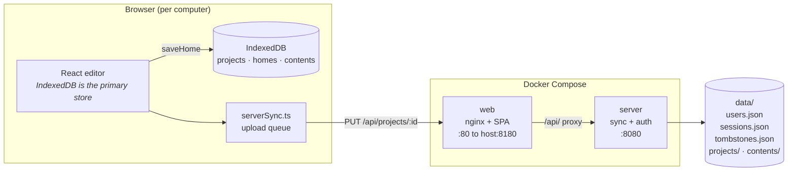
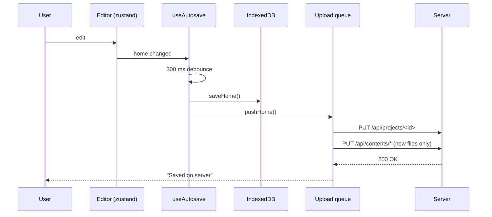

<div align="center">

# swethome3d

**Sweet Home 3D in the browser — self-hosted, with login and projects stored on the server.**

A self-hosting fork of [Paul6552/sweet3D](https://github.com/Paul6552/sweet3D),
the web port of [Sweet Home 3D](https://www.sweethome3d.com).

[](LICENSE)
[](https://github.com/Paul6552/sweet3D)
[](docker-compose.yml)

</div>

---

## Why this fork

The upstream project is **purely client-side**: projects live in the browser's
IndexedDB, there is no server and no login. The same user on a second computer
therefore sees an empty project list, and work is only recoverable through manual
`.sh3d` exports.

This fork keeps the editor exactly as it is and adds the missing layer:

| | |
| --- | --- |
| 🔐 **Login** | Sessions with `httpOnly` cookies, scrypt password hashes, roles |
| 👥 **User management** | Admin dashboard to create, disable, reset or delete users |
| ☁️ **Server-side projects** | Projects, thumbnails and imported files stored on disk |
| 💻 **Local-first** | The editor keeps working when the server is unreachable |
| 📊 **Sync feedback** | A badge shows whether a change reached the server |
| 🐳 **One-command deploy** | `./deploy.sh up` builds and starts everything |

---

## Table of contents

- [What this fork changes](#what-this-fork-changes)
- [Architecture](#architecture)
- [Quick start](#quick-start)
- [First login](#first-login)
- [How synchronization works](#how-synchronization-works)
- [User management](#user-management)
- [Configuration](#configuration)
- [Commands](#commands)
- [Backup and restore](#backup-and-restore)
- [Repository layout](#repository-layout)
- [Design decisions](#design-decisions)
- [Troubleshooting](#troubleshooting)
- [Licensing](#licensing)
- [Credits](#credits)

---

## What this fork changes

Upstream sources are **never patched**. `deploy.sh` clones the original into
`src/` and then copies [`overlay/`](overlay) on top of it. This survives
`git reset --hard` during updates, so upstream improvements can always be pulled
in while the local layer stays intact.

### New components

| Component | File | Purpose |
| --- | --- | --- |
| Sync + auth server | [`server/index.mjs`](server/index.mjs) | REST API for projects, thumbnails, imported files, login and user management. Node.js, **zero npm dependencies**. |
| Server image | [`server/Dockerfile`](server/Dockerfile) | `node:24-alpine`, data under `/data` |
| Sync engine | [`overlay/src/storage/serverSync.ts`](overlay/src/storage/serverSync.ts) | Per-project upload queue, startup pull, retries, conflict rule |
| Sync status store | [`overlay/src/storage/syncStatus.ts`](overlay/src/storage/syncStatus.ts) | zustand store holding the state per project |
| Sync status badge | [`overlay/src/storage/SyncStatusBadge.tsx`](overlay/src/storage/SyncStatusBadge.tsx) | Pill in the bottom-left corner of the editor |
| Login page | [`overlay/src/auth/LoginPage.tsx`](overlay/src/auth/LoginPage.tsx) | Username/password sign-in |
| Dashboard | [`overlay/src/auth/DashboardPage.tsx`](overlay/src/auth/DashboardPage.tsx) | "Launch Sweet3D" plus user management for admins |
| User management | [`overlay/src/auth/UserManagement.tsx`](overlay/src/auth/UserManagement.tsx) | Create, change role, disable, reset password, delete |
| Account menu | [`overlay/src/auth/AccountMenu.tsx`](overlay/src/auth/AccountMenu.tsx) | Dashboard / sign out inside the editor |
| API client | [`overlay/src/auth/api.ts`](overlay/src/auth/api.ts) | Fetch wrapper, `ApiError`, roles |
| Translations | [`overlay/src/auth/authI18n.ts`](overlay/src/auth/authI18n.ts) | de/en strings for login, dashboard and sync badge |
| Compatibility shims | [`overlay/src/compat.ts`](overlay/src/compat.ts) | `crypto.randomUUID` and `navigator.locks` for insecure origins |

### Patched upstream files

| File | Change |
| --- | --- |
| [`overlay/src/router.tsx`](overlay/src/router.tsx) | New routes `/login`, `/` (dashboard) and `/app`; auth guard on every editor route; status badge and account menu mounted at the root |
| [`overlay/src/storage/projects.ts`](overlay/src/storage/projects.ts) | Each local write now also triggers sync (`createProject`, `saveHome`, `renameProject`, `deleteProject`, `saveThumbnail`, `saveContents`) |
| [`overlay/src/storage/contents.ts`](overlay/src/storage/contents.ts) | Missing imported files are downloaded from the server and cached |
| [`overlay/nginx.conf`](overlay/nginx.conf) | Reverse proxy `/api/` → `server:8080`, `client_max_body_size 1024m`, `no-store` for `index.html` |
| [`overlay/vite.config.ts`](overlay/vite.config.ts) | Dev proxy for `/api` (`SWEET3D_SYNC_URL`, default `http://localhost:8080`) |

### Deployment changes

| File | Change |
| --- | --- |
| [`docker-compose.yml`](docker-compose.yml) | Second service `server`, `./data` volume, `depends_on`, healthchecks |
| [`deploy.sh`](deploy.sh) | Overlay step after every clone/update, new `overlay` and `passwd` commands |
| [`.env.example`](.env.example) | New variables for login, sessions and upload limits |

---

## Architecture



Only nginx is exposed to the host. The `server` service publishes no port and is
reachable exclusively through the `/api/` proxy.

---

## Quick start

Requirements: Docker with the Compose plugin, `git`, `bash`.

```bash
git clone https://github.com/ske087/swethome3d-in-docker_with-user-.git
cd swethome3d-in-docker_with-user-

cp .env.example .env      # optional: adjust port, admin name, limits
./deploy.sh up
```

On the first run the script

1. clones the upstream project into `src/`,
2. applies `overlay/`,
3. builds both images,
4. creates the admin account and logs its password **once**.

```bash
docker compose logs server | grep -A 5 'initial admin account'
```

Then open:

```
http://<server-ip>:8180
```

> 💡 Set `ADMIN_PASSWORD` in `.env` to choose the password yourself, or run
> `./deploy.sh passwd` at any time to generate a new one.

---

## First login

1. **Dashboard** — greeting, a "Sweet3D" card with the launch button, and (for
   admins) the user table below it.
2. **Launch Sweet3D** → `/app` → opens the last edited project, creating one on
   first use.
3. Inside the editor, bottom left: the account menu (Dashboard / Sign out) and
   the sync badge.

---

## How synchronization works

IndexedDB stays the **primary store**. The server is a replica, not a
replacement — that is why the editor keeps working offline.



### Triggers

| Action | Request |
| --- | --- |
| Create project | `PUT /api/projects/:id` + its files |
| Edit (autosave) | `PUT /api/projects/:id` |
| Rename | `PATCH /api/projects/:id` (name only) |
| New thumbnail | `PUT /api/projects/:id/thumbnail` |
| Delete | `DELETE /api/projects/:id` + `POST /api/maintenance/cleanup` |
| Imported models/textures | `PUT /api/contents/:key`, once per file |

`useAutosave` also flushes on `visibilitychange → hidden` and on `pagehide`, so
closing the tab loses nothing.

### The badge in the editor

| Display | Meaning |
| --- | --- |
| ⏳ *Saving to server …* | upload in flight |
| ☁✓ *Saved on server · HH:MM* | the server confirmed this version |
| ☁✗ *Saved locally only* | server unreachable; data is safe locally and retried automatically (5 s → 60 s). **Click** to retry now |

After a reload the badge shows the time of the last successful sync. If the
server was down at startup it says "Saved locally only" on purpose, instead of
silently claiming success.

### Conflicts and deletions

- **Conflicts:** per project the larger `updatedAt` wins (last write wins).
  There is no field-level merge — deliberately, since merging two house models
  has no meaningful semantics for walls, levels and linked IDs.
- **Offline edits:** if the local copy is newer than the server copy, it is
  uploaded again on the next start.
- **Deletions:** the server keeps tombstones, so a computer that was offline
  cannot resurrect a deleted project.
- **Interrupted uploads:** harmless — IndexedDB holds the complete state and the
  next start reconciles.

### A note on imported model files

Models and textures are not embedded in `home.json`; they are referenced as
`content:<key>`. Uploading a project also uploads every referenced file once
into `data/contents/`. On another computer the browser fetches missing files on
first use and caches them locally.

---

## User management

Visible to the `admin` role only (dashboard → "User management"):

| Action | Behaviour |
| --- | --- |
| Create | Username 3–32 chars (`a–z`, `0–9`, `.`, `_`, `-`), password ≥ 8 chars, role selectable |
| Change role | `admin` ↔ `user` |
| Disable | Blocks sign-in and terminates existing sessions |
| Reset password | Sets a new password and signs out all sessions of that user |
| Delete | Removes the user and their sessions |

Server-side guard rails:

- the last active administrator cannot be demoted, disabled or deleted,
- nobody can disable or delete themselves,
- usernames are unique (case-insensitive).

Passwords are stored as **scrypt** hashes with a per-user salt in
`data/users.json` — never in plain text. Sessions are `httpOnly`,
`SameSite=Lax` cookies (`COOKIE_SECURE=1` adds `Secure` for HTTPS deployments).

### Lost password

```bash
./deploy.sh passwd            # the ADMIN_USER account
./deploy.sh passwd maria      # any user
```

Generates a random password, prints it once and invalidates the user's open
sessions. The running server detects the change in `users.json` and picks it up
**without a restart**.

---

## Configuration

Everything lives in `.env` (see [`.env.example`](.env.example)):

| Variable | Default | Meaning |
| --- | --- | --- |
| `WEB_BIND` | `0.0.0.0` | Host address (use `127.0.0.1` behind a reverse proxy) |
| `WEB_PORT` | `8180` | Host port |
| `IMAGE_TAG` | `latest` | Tag of the locally built images |
| `UPSTREAM_REPO` | `…/Paul6552/sweet3D.git` | Upstream source |
| `UPSTREAM_BRANCH` | `main` | Upstream branch |
| `ADMIN_USER` | `admin` | Name of the first administrator |
| `ADMIN_PASSWORD` | *(empty)* | empty = random password on first start |
| `SESSION_TTL_DAYS` | `30` | Session lifetime |
| `COOKIE_SECURE` | `0` | `1` when served over HTTPS |
| `MAX_CONTENT_MB` | `1024` | Limit per imported file |

Apply changes with `docker compose up -d`.

---

## Commands

| Command | Effect |
| --- | --- |
| `./deploy.sh up` | Clone/update, apply overlay, build, start *(default)* |
| `./deploy.sh update` | Fetch the latest upstream commit, apply overlay, rebuild |
| `./deploy.sh overlay` | Copy `overlay/` into `src/` only (no rebuild) |
| `./deploy.sh passwd [user]` | Generate a new password, end that user's sessions |
| `./deploy.sh logs` | Follow the logs of both containers |
| `./deploy.sh status` | Container status |
| `./deploy.sh restart` / `stop` / `down` | Restart / stop / remove |

Or directly with Docker:

```bash
docker compose up -d --build
docker compose logs -f server
```

### Local development

```bash
cd src
npm install
npm run dev                      # http://localhost:5173

# Sync server separately (Node >= 20)
cd ../server
DATA_DIR=../data PORT=8080 ADMIN_PASSWORD=devadmin123 node index.mjs
```

`vite.config.ts` proxies `/api` to `http://localhost:8080`, overridable with
`SWEET3D_SYNC_URL`.

---

## Backup and restore

All mutable state is in `./data`:

```
data/users.json        # users (scrypt hash + salt)
data/sessions.json     # active sessions
data/tombstones.json   # deleted project ids
data/projects/<id>/    # meta.json, home.json, thumbnail.webp
data/contents/         # imported models and textures
```

```bash
# backup
tar czf swethome3d-backup-$(date +%F).tar.gz data/

# restore
./deploy.sh stop
tar xzf swethome3d-backup-YYYY-MM-DD.tar.gz
./deploy.sh up
```

A per-project `.sh3d` export is also worth keeping — it is the original format
and readable without this application.

---

## Repository layout

```
swethome3d-in-docker_with-user-/
├── docker-compose.yml    # web (nginx) + server (sync/auth)
├── deploy.sh             # clone, overlay, build, start
├── .env.example          # configuration template
├── README.md
├── LICENSE               # MIT (upstream + this fork)
├── NOTICE                # Sweet Home 3D and catalog licenses
│
├── overlay/              # local layer copied over src/
│   ├── nginx.conf
│   ├── vite.config.ts
│   └── src/
│       ├── compat.ts
│       ├── router.tsx
│       ├── auth/         # login, dashboard, users, API client
│       └── storage/      # projects, contents, sync, status
│
└── server/               # sync + auth server
    ├── Dockerfile
    ├── package.json
    └── index.mjs
```

> `src/` is **not** part of this repository. It is a clone of the upstream
> project created by `deploy.sh` (see `.gitignore`). `data/` and `.env` are
> excluded for the same reason.

---

## Design decisions

**Why an overlay instead of patches?**
`deploy.sh` runs `git reset --hard` and `git clean -fd` in `src/` when updating.
An overlay directory is the only approach that survives updates and stays
reviewable (`deploy.sh overlay`).

**Why local-first instead of server-first?**
The editor relies on synchronous local reads for undo/redo and for detached
panel windows (BroadcastChannel). A network round-trip per change would hurt
responsiveness and make the editor unusable without a connection.

**Why last-write-wins?**
Merging two house models field by field has no meaningful semantics (IDs,
levels, linked walls). A documented winner is more honest than a half-correct
merge.

**Why `compat.ts`?**
`crypto.randomUUID()` and `navigator.locks` exist in Firefox **only in secure
contexts** (HTTPS or `localhost`). Over `http://192.168.x.x:8180` both are
missing — but the editor touches them while its modules load, so the bundle
would throw and every route would stay blank. The shim builds UUIDs from
`crypto.getRandomValues` (available insecurely) and replaces Web Locks with a
lease-based lock over `BroadcastChannel`.

**Why no npm dependencies on the server?**
It only uses `node:http`, `node:fs` and `node:crypto`. The image stays small,
there is no supply-chain surface and no `npm audit` noise.

---

## Troubleshooting

| Symptom | Cause / fix |
| --- | --- |
| **Blank page on another computer** | Usually a stale image. Run `docker compose build web && docker compose up -d --force-recreate`, then hard reload (`Ctrl+Shift+R`). Verify: `docker exec swethome3d-web grep -c sweet3d-locks /usr/share/nginx/html/assets/index-*.js` must return `1`. |
| **Blank page after an update** | The browser cached `index.html`. nginx now sends `no-store`; reload once with `Ctrl+Shift+R`. |
| **Sign-in stopped working** | Reset the password: `./deploy.sh passwd`. |
| **Password reset has no effect** | Only on very old images — the server now reloads `users.json` when it changes. |
| **"Saved locally only" never clears** | Check the server: `docker compose ps`, `docker compose logs server`. Then click the badge. |
| **Imported models missing on the second PC** | The first upload must have finished (watch `data/contents/`). Check the badge, then reopen the project. |
| **`413 Payload Too Large`** | Raise `MAX_CONTENT_MB` and `client_max_body_size` in `nginx.conf`, then rebuild. |
| **Port already in use** | Change `WEB_PORT` in `.env`, then `docker compose up -d`. |

---

## Licensing

This is a **fork** and keeps the original licensing.

| Scope | License |
| --- | --- |
| Sweet3D source code (upstream) | **MIT** — Copyright © 2026 Christoph Paul Pedretscher |
| Docker deployment, auth and sync additions | **MIT** (same license) |
| `SweetHome3D.jar`, `Furniture.jar`, `Textures.jar` and the catalog generated from them | **GPL-2.0-or-later** (Sweet Home 3D, Space Mushrooms) |
| Catalogs built by `scripts/build-packs.mjs` | per entry: CC0, CC-BY, Free Art License and others |

See [`LICENSE`](LICENSE) and [`NOTICE`](NOTICE) for details.

The additions deliberately stay under MIT so they remain compatible with
upstream and can be offered back as a patch.

---

## Credits

- **[Sweet Home 3D](https://www.sweethome3d.com)** by Emmanuel Puybaret /
  Space Mushrooms — data model, catalogs, `.sh3d` format.
- **[Paul6552/sweet3D](https://github.com/Paul6552/sweet3D)** — the web port
  this fork builds upon.
- **[Poly Haven](https://polyhaven.com)** — CC0 models and textures.

This fork is not affiliated with the upstream project or with Space Mushrooms.
